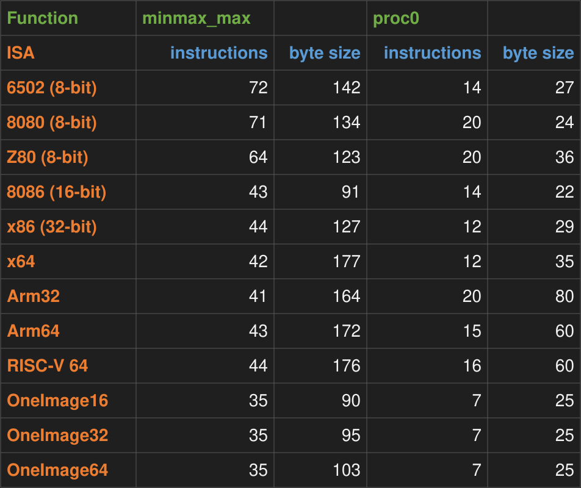

# OneImage

OneImage is a prototype ISA that's more efficient than popular ISAs

Details can be found here: [OneImage](https://medium.com/@davidly_33504/oneimage-towards-a-more-perfect-cpu-5ea8b418cd5e)

In short, CPUs with instruction sets similar to the one proposed will run code more efficiently than Arm64, x64, and RISC-V 64. The ISA is easier to target with compilers. Also, because it has fewer registers, fewer transistors would be required.

Two functions in tttoi.s as compared with assembly implementations for other ISAs found [here](https://github.com/davidly/ttt)



OneImage rows are static counts from the current tttoi.s, measured from each function's label to the next
function's label in the `oia -l` listing at each image width.

## Benchmark instruction counts

Instructions executed by the assembly benchmarks. Counts are identical for
2-, 4-, and 8-byte image widths.

| benchmark   | instructions |
|-------------|-------------:|
| eoi.s       |      140,018 |
| sieveoi.s   |      245,179 |
| tttoi.s     |      185,558 |

To measure counts, build an interpreter without `-DNDEBUG` and run it with `-p`:

```sh
c++ -std=c++11 -O2 -DOI2 -Wno-deprecated-declarations -I . -x c++ oios.c oi.c trace.c oidis.c -o oios2d
./oia -w:2 sieveoi.s
./oios2d -p sieveoi
```

Debug builds also accept `-t -i` to write a per-instruction trace to `oios.log`, which is useful
for finding the hottest instructions.

The manx, hisoft, and mscv6 folders contain build scripts for compiling oios with CP/M 2.2 and DOS compilers found in [cpm_compilers](https://github.com/davidly/cpm_compilers) and [dos_compilers](https://github.com/davidly/dos_compilers) using NTVCM and NTVDM emulators found in sister repos.


Build all host tools with a C++11 compiler (GCC or Clang on Linux/macOS,
MSVC on Windows). The build creates the BASIC compiler `ba`, assembler `oia`,
and the 16-, 32-, and 64-bit interpreters `oios2`, `oios4`, and `oios8`.

On Linux/macOS:

```sh
./mall.sh
python3 tests/regression.py --tools-dir .
```

Set `CXX=clang++` to use Clang. On Windows, open an MSVC developer command
prompt and run:

```bat
mall.bat
python tests\regression.py --tools-dir .
```

The build-all scripts stop if any component fails. To rebuild one tool, use
`mba`, `mar`, `mr2`, `mr4`, or `mr8` with the platform's `.sh` or `.bat` suffix.
The shell scripts can also be invoked from outside the repository.

Tests require Python 3.7 or newer. Omit `--tools-dir .` to compile fresh tools
in a temporary directory instead. On Linux/macOS, use
`python3 tests/regression.py --sanitize` for address and undefined-behavior
checks with GCC/Clang, or `--cc clang++` to select a test compiler.
The tests include local BASIC compilation and every supported image/interpreter
width combination.

For example, compile and run a BASIC sample on Linux/macOS:

```sh
./ba -q -a:o -x basic/tneg1.bas
./oia -w:2 basic/tneg1.s
./oios2 basic/tneg1
```

On Windows, use the same commands without `./` and with Windows path separators.
BA is built from `ba.cxx` and its included `ba8008.hxx` backend.
After building, run `./runall.sh` on Linux/macOS or `runall.bat` on Windows
for the full assembly and BASIC sample matrix, including the ISA suites.
These runners use the local tools and Python 3.7+ to compare `test_oios.txt`
against the checked-in `baseline_test_oios.txt`. The comparison ignores platform
line endings and trailing spaces; values and case must match. Output excludes
wall-clock timestamps so the same baseline works on both platforms.


The standalone assembly suites in `tests/isa_arithmetic.s`, `tests/isa_relations.s`,
and `tests/isa_memory.s` contain 167 numbered assertions. They cover ALU and
stack operand ordering, signed division, shifts and extension, all eight
relations with taken and untaken branches, conditional moves, byte/native
memory access, index scaling, unaligned access, bulk boundaries, and stack
balance. Each prints its name followed by `PASS`, or `FAIL assertion N`.
The Python runner checks the exact success output for all six supported
image/interpreter width combinations. Existing targeted regressions additionally
cover calls, returns, signed frame offsets, and relative-branch boundaries.

Run an assembly suite individually, for example:

```sh
./oia -w:2 tests/isa_arithmetic.s
./oios2 tests/isa_arithmetic
```
